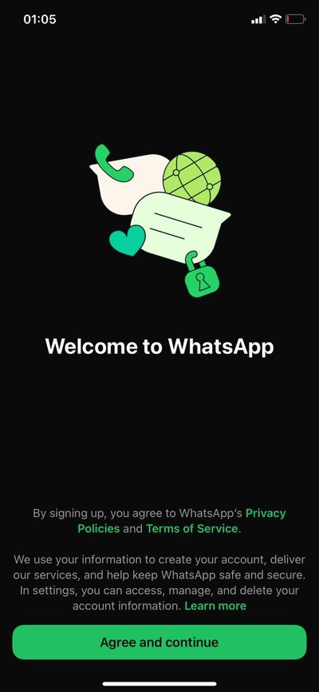
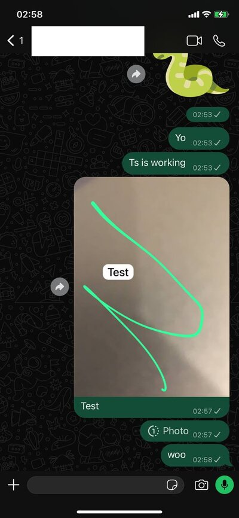
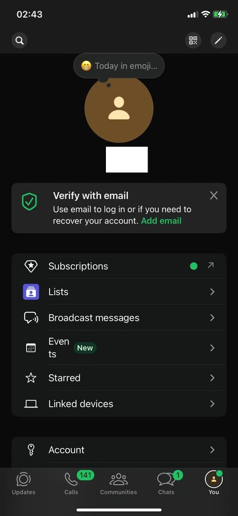
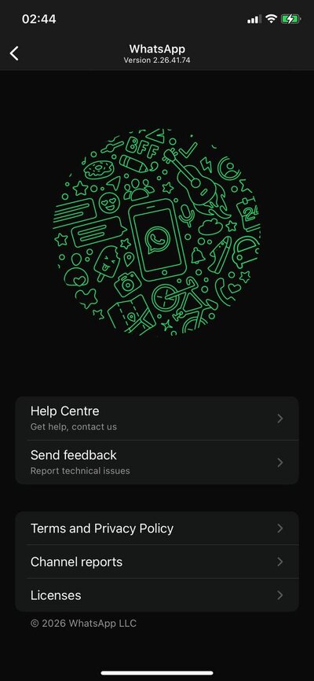

# waport

A porting suite that runs **WhatsApp 26.41.74** (built for iOS 15.1 and later only) on
**iOS 14**, installed with [TrollStore](https://github.com/opa334/TrollStore). TrollStore
keeps the original bundle ID and entitlements, so push notifications keep working.
Developed and tested on iOS 14.3, arm64e.

On iOS 14.3 WhatsApp registers, logs in, and shows the chat list and chats. Some screens may
still crash: [the WhatsApp notes](profiles/net.whatsapp.WhatsApp/NOTES.md) list the iOS 15
APIs that aren't implemented yet.

<p align="center">




</p>

This is a first step in backporting, not a general-purpose patcher. Much of the code doesn't
depend on WhatsApp and is kept separate from the WhatsApp-specific parts
(`profiles/net.whatsapp.WhatsApp/`), but it has only been tested with this one app and
version. Another app or WhatsApp version will need more work.

The repo contains only the porting tools. **It contains no binaries**: you supply the
decrypted IPA and the dyld shared cache of your iOS version.

Not affiliated with or endorsed by WhatsApp or Meta.

## How it works

The app loads, and every import it makes resolves to *something*:

- real code on iOS 14 (moved symbols retargeted, back-deployed Swift Concurrency)
- a fallback in the shim (`libwaport.dylib`): iOS 15/16 ObjC methods, C functions and
  constants with an iOS 14 equivalent, and iOS 15 Swift overlay APIs written in Swift
- a **trap**: an API that iOS 14 doesn't have and the shim doesn't implement yet. A trap
  writes the symbol name and a backtrace to `waport.log`, then aborts

So a screen that reaches a trapped API may crash, and the log names the API. Continuing the port
means: install, use it, read the log, implement the trapped API in `src/` (or in the
WhatsApp profile, if it's specific to WhatsApp), and rebuild.

## Requirements

- iPhone on iOS 14.x with TrollStore. arm64e (A12+) has been tested.
- Linux host: `python3` (venv), `unzip`, [theos](https://theos.dev) at `$THEOS` (default
  `~/theos`) with its Linux toolchain (`clang`, `ldid`), `sdks/iPhoneOS14.5.sdk`, and the
  `swift-5.8` toolchain (`swiftc` for `src/overlays.swift`, the `libswift_Concurrency`
  back-deploy, `swift-demangle`) with `sdks/iPhoneOS15.6.sdk` (Swift interfaces), plus [apfs-fuse](https://github.com/sgan81/apfs-fuse)
- A **decrypted** IPA (`cryptid 0`), e.g. from TrollDecrypt
- `dyld_shared_cache_arm64e` of your iOS version: download its IPSW, mount the largest
  `.dmg` read-only with apfs-fuse, and copy
  `System/Library/Caches/com.apple.dyld/dyld_shared_cache_arm64e`

## Build

```sh
./build.sh app_decrypted.ipa path/to/dyld_shared_cache_arm64e [out.tipa]
WAPORT_LOG=1 ./build.sh ... out-diag.tipa      # diagnostic build
```

`build.sh` creates a venv with `dyldextractor` on first run, patches (`tools/patch.py`),
then runs an independent offline load check (`tools/verify.py`). Every image must print
`ok`. `work/missing.txt` lists every symbol the target lacks and what was done with it
(`func`/`async` trap, `enumcase` zero constant, `data` weak null).

Environment overrides: `WORK`, `THEOS`, `SDK`, `CONCURRENCY`, `DYLDEX`, `TARGET_IOS`
(minos written, default 14.0), `CACHE_IOS` (cache version checked against, default
14.3), `PROFILE`.

## Install

1. Back up first. Use an encrypted backup (`idevicebackup2 encryption on …; idevicebackup2
   backup --full DIR`), because only encrypted backups include the keychain.
2. Open the `.tipa` with TrollStore → Install. If the App Store version is installed, **don't
   delete it** (that deletes its data). TrollStore reports error 171, so choose **Force
   Installation**: it replaces only the `.app` bundle, and the data container, app-group
   containers and keychain stay.
3. To update later, install over it again. **Never uninstall it from TrollStore**: that
   deletes the data and app-group containers.

## Logs

`Documents/waport.log` in the app's container:

| Line | Meaning |
|---|---|
| `TRAP missing function <symbol>` + backtrace | API missing on this iOS → implement it (always logged) |
| `UNRECOGNIZED -[Class sel]` | ObjC method missing → add a fallback to `src/compat.m` (diagnostic build) |
| `UNCAUGHT` / `TERMINATE` | ObjC exception / C++ `std::terminate` with the thrown type (diagnostic build) |
| `added -[Class sel]` | a fallback was installed (diagnostic build) |

Diagnostic builds set `UIFileSharingEnabled`, so the log is in **Files → On My iPhone →
<app>**. With a release build, use Filza, or the `NSLog` lines (`waport:`) via
`idevicesyslog`. App extensions log into their own container, so use syslog for those.

## Layout

| | |
|---|---|
| `build.sh` | patch → verify |
| `tools/patch.py` | the patcher (app-independent; WhatsApp is the only app tested) |
| `tools/verify.py` | offline load check against the dyld cache |
| `tools/machotool.py` | Mach-O, chained fixups, binds, export tries, stubs; dyld-cache export resolver |
| `tools/traps.py` | missing-symbol classification, trap generation |
| `tools/scan_objc.py` | iOS 15.0–15.1 ObjC methods an app may call unguarded (analysis) |
| `tools/callsites.py` | approximate call sites per import (analysis) |
| `src/` | the shim, `libwaport.dylib` (see `src/build-shim.sh`) |
| `screenshots/` | WhatsApp 26.41.74 on iOS 14.3 |
| `profiles/net.whatsapp.WhatsApp/` | WhatsApp-specific: `profile.json`, `NOTES.md`, extra shim sources (`*.m`) |

## License

[CC0 1.0](LICENSE).
